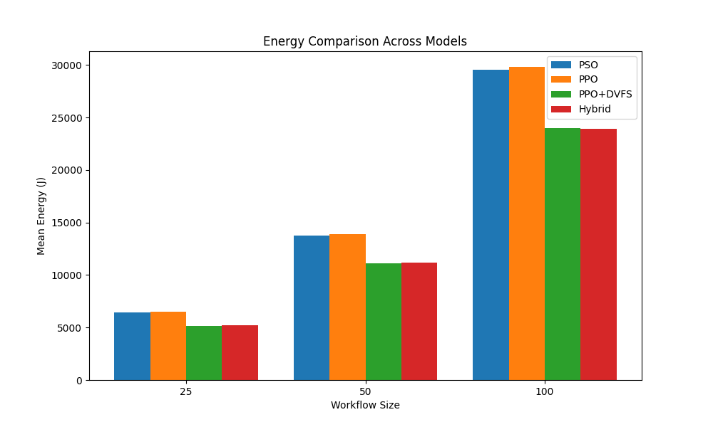
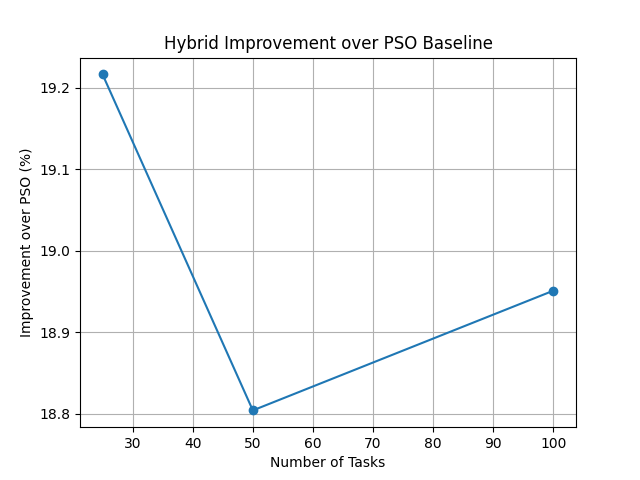

# Energy-Aware Workflow Scheduling with PSO, PPO and DVFS

Energy-aware scheduling of DAG-based scientific workflows across **edge, fog and cloud** computing nodes. The project combines **Particle Swarm Optimization (PSO)** for task-to-node placement with a **Proximal Policy Optimization (PPO)** reinforcement-learning agent that controls **Dynamic Voltage and Frequency Scaling (DVFS)**, plus post-scheduling **task migration**.

Developed as part of my Master's thesis in Computer Science.

## Key result

Adding learned DVFS control cuts energy cost by **about 19% compared with a PSO-only scheduler**, and the saving holds as workflows grow from 25 to 100 tasks.

| Workflow size | PSO only | PPO only | PPO + DVFS | Hybrid (PSO + PPO-DVFS) | Hybrid saving vs PSO |
|---|---|---|---|---|---|
| 25 tasks  | 6,449 J  | 6,487 J  | 5,181 J  | 5,209 J  | 19.2% |
| 50 tasks  | 13,782 J | 13,890 J | 11,123 J | 11,190 J | 18.8% |
| 100 tasks | 29,525 J | 29,823 J | 23,979 J | 23,930 J | 19.0% |

*Mean of 5 trials per configuration. Raw numbers: [`results/four_model_comparison.csv`](results/four_model_comparison.csv).*





## How it works

1. **Workflow generation**: synthetic layered DAGs (25, 50, 100 tasks), where each task has CPU demand, memory and runtime.
2. **Resource model**: three heterogeneous nodes:

   | Node | Layer | CPU | Idle power | Full-load power |
   |---|---|---|---|---|
   | Edge1  | edge  | 1.2 GHz | 10 W | 25 W |
   | Fog1   | fog   | 2.5 GHz | 20 W | 40 W |
   | Cloud1 | cloud | 3.6 GHz | 30 W | 60 W |

   Execution time scales inversely with frequency, and dynamic power scales with the **cube** of frequency. DVFS modes: `low` (0.6×), `normal` (1.0×), `boost` (1.3×).
3. **PSO scheduler**: searches for the task-to-node assignment that minimises total energy.
4. **PPO agent** (Stable-Baselines3 + Gymnasium): a custom environment where, for each task, the agent picks a node and a DVFS mode (full control), or only a DVFS mode on top of the PSO placement (hybrid).
5. **Task migration**: after scheduling, CPU-heavy tasks stuck on weak nodes are moved to a stronger tier.

### Four models compared

| Model | Placement | DVFS |
|---|---|---|
| PSO only | PSO | off |
| PPO only | PPO | off |
| PPO + DVFS | PPO | PPO |
| Hybrid | PSO | PPO, plus migration |

## Project structure

```
├── core/
│   ├── dag_parser.py          # Load workflow JSON into a NetworkX DAG
│   └── node.py                # Resource node with DVFS and energy model
├── models/
│   ├── pso_scheduler.py       # Particle Swarm Optimization scheduler
│   └── rl_scheduler_env.py    # Gymnasium environment for PPO
├── engine/
│   └── task_migrator.py       # Post-scheduling task migration
├── workflows/                 # Generated DAG workflows (25 / 50 / 100 tasks)
├── results/                   # Experiment CSV and charts
├── workflow_generator.py      # Generate synthetic DAG workflows
├── train_rl_agent.py          # Train hybrid PPO (DVFS on PSO placement) -> ppo_scheduler.zip
├── train_ppo_full.py          # Train full-control PPO -> ppo_scheduler_full.zip
├── train_ppo_dvfs.py          # Train DVFS-only PPO -> ppo_scheduler_dvfs.zip
├── master_experiment.py       # Run the four-model comparison
├── test_rl_agent.py           # Run the trained hybrid agent on one workflow
├── main.py                    # PSO + migration demo
├── Visuals.ipynb              # Charts for the results
└── ppo_scheduler*.zip         # Pre-trained PPO models
```

## Getting started

Requires Python 3.10+.

```bash
git clone https://github.com/Aneesh291/energy-aware-workflow-scheduling-pso-ppo.git
cd energy-aware-workflow-scheduling-pso-ppo
pip install -r requirements.txt
```

Run the full four-model experiment with the included pre-trained models:

```bash
python master_experiment.py
```

Or reproduce everything from scratch:

```bash
python workflow_generator.py     # 1. generate workflows
python train_ppo_full.py         # 2. train PPO models
python train_ppo_dvfs.py
python train_rl_agent.py
python master_experiment.py      # 3. compare the four models
```

Other entry points:

```bash
python main.py            # PSO scheduling + task migration demo
python test_rl_agent.py   # hybrid PSO + PPO agent, task by task
```

## Notes

- The energy figures are the accumulated cost from the RL reward. This includes the energy model plus small penalty terms for load and poor DVFS choices, so it's a relative cost for comparing models rather than measured hardware energy.
- PPO + DVFS and the Hybrid perform about the same. The main saving comes from learned DVFS control, not from the placement method.
- The simulation uses three nodes and synthetic workflows. Real-world traces and larger clusters are natural next steps.

## Tech stack

Python · Stable-Baselines3 (PPO) · Gymnasium · PyTorch · NetworkX · NumPy · pandas · Matplotlib

## License

MIT. See [LICENSE](LICENSE).
